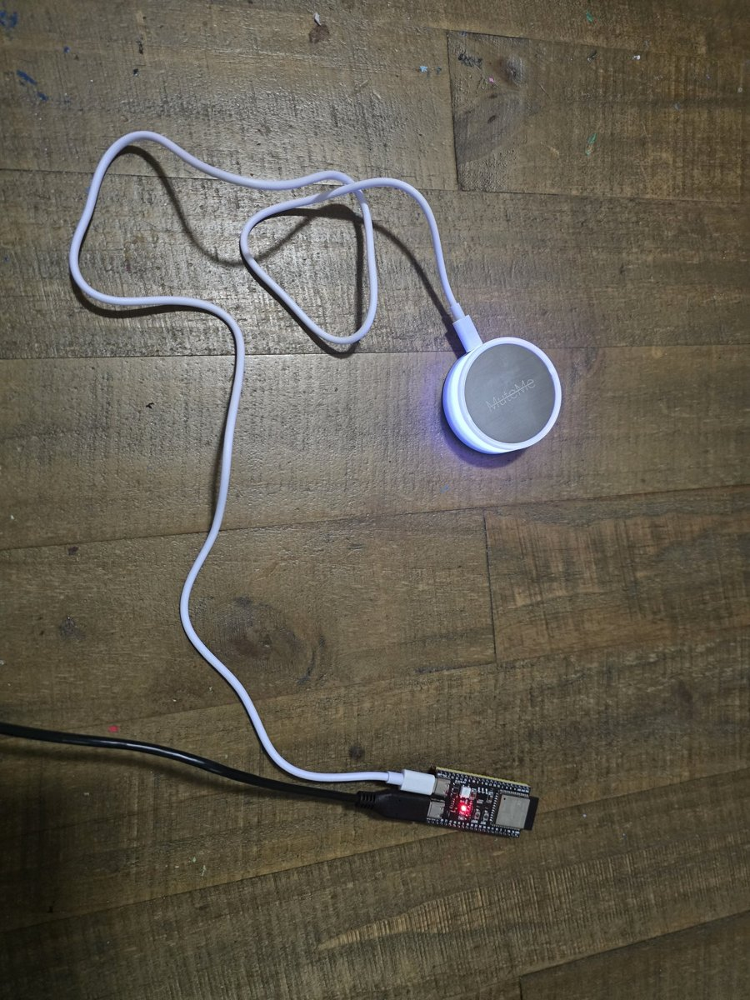
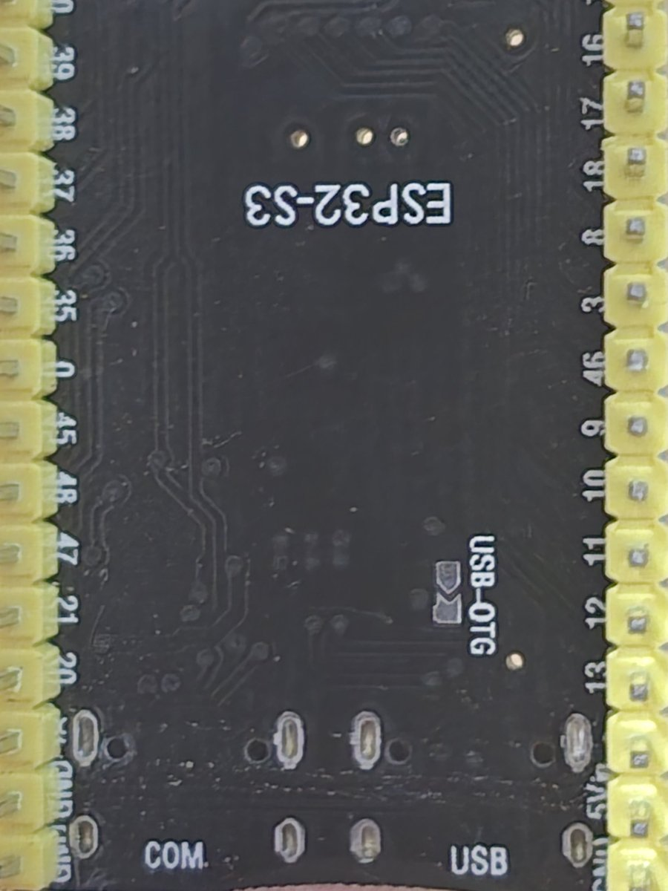
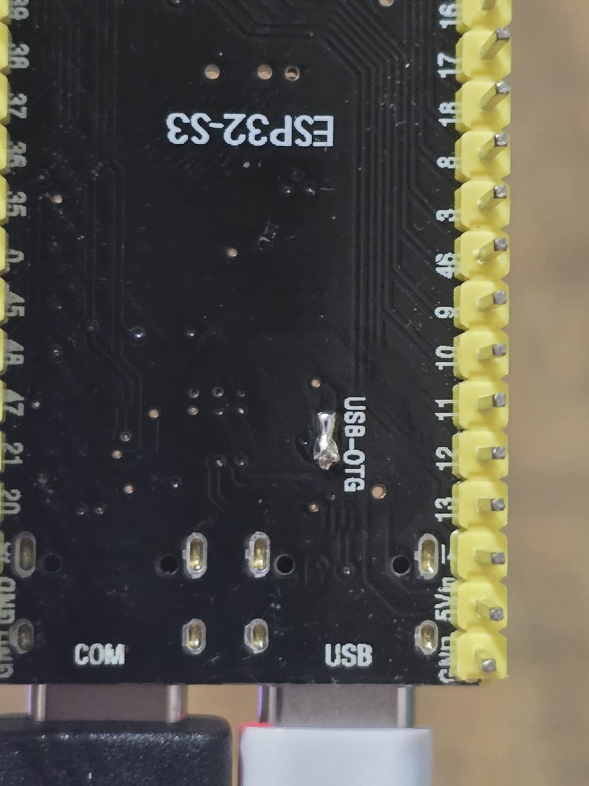
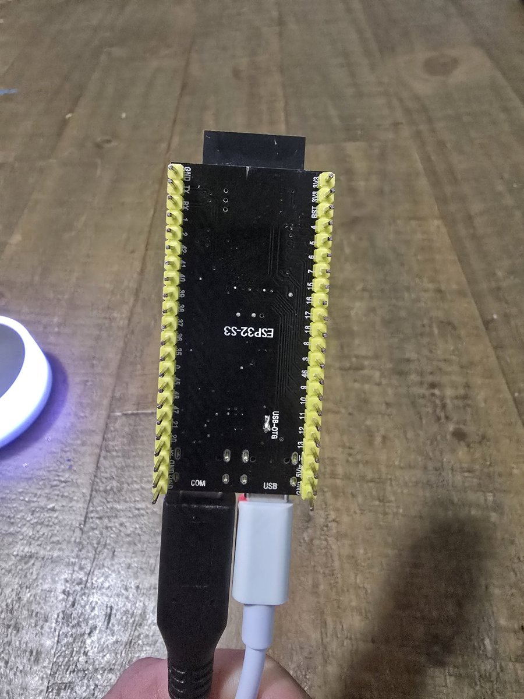
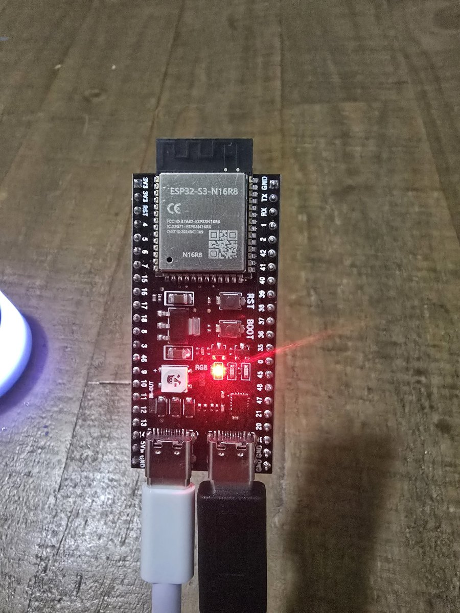

# MuteMe → Home Assistant (ESPHome on an ESP32-S3)

Turn a [MuteMe](https://muteme.com/) button into a Home Assistant status light and touch button — no MuteMe app, no computer.

An ESP32-S3 acts as a **USB host**: the MuteMe plugs straight into the ESP32's USB port, and a custom ESPHome component talks to it over USB HID. In Home Assistant you get the button's touch events and full control of its LED.

I built this because my MuteMe was useless to me: it can't plug into a phone, and my work PC can't install the MuteMe software. Now it sits on my desk showing household alerts from Home Assistant.

## What you get in Home Assistant

| Entity / event | What it does |
|---|---|
| `binary_sensor` **Touch** | On while you're touching the button |
| `select` **LED colour** | off, red, green, yellow, blue, purple, cyan, white |
| `select` **LED mode** | solid, dim, fast_pulse, slow_pulse |
| `select` **LED effect** | none, rainbow, rainbow_breathe, red_blue, traffic_light |
| `number` **Effect step time** | Speed of the effects |
| `binary_sensor` **Button connected** | Diagnostic: is the MuteMe plugged in |
| Event `esphome.muteme_button` | `action: tap`, `double_tap` or `long_press` |
| Action `esphome.muteme_bridge_set_led` | Set `color` and `mode` in one call |

## Hardware

- **ESP32-S3 dev board with two USB-C ports.** I used a clone of the ESP32-S3-DevKitC-1 (VCC-GND Studio YD-ESP32-S3, N16R8). An S2 should also work. **The original ESP32, C3 and C6 can't act as a USB host, so they won't work.**
- **A MuteMe** (original or Mini).
- A USB charger and a USB-C cable.
- A soldering iron, for one solder bridge.

### The one hardware mod: power the USB port

Out of the box, the S3's native **USB** port doesn't supply 5 V to a plugged-in device, so the MuteMe gets no power. The clone board has a solder jumper on the back labelled **USB-OTG** that fixes this by bypassing a diode in the VBUS line.

1. Find the two pads labelled **USB-OTG** on the underside of the board.
2. Add a little flux, tin both pads, and join them with a small blob of solder.
3. Check with a multimeter: the pads should beep for continuity, and the bridge must **not** connect to GND.

| Before: USB-OTG pads open | After: pads bridged with solder |
|---|---|
|  |  |

> **Warning:** once the pads are bridged, the two USB ports share 5 V. Never plug both ports into computers or chargers at the same time.
>
> Leave the **IN-OUT** jumper alone; it isn't needed here. On the official Espressif DevKitC-1 there is no USB-OTG pad, so you'd need a powered hub or an OTG Y-cable instead.

### Wiring

- Charger (or your PC, for the first flash) → **COM** port
- MuteMe → **USB** port

The port names are printed on the back of the board:

| Back (port labels) | Front |
|---|---|
|  |  |

## Software setup

1. **Add the secrets.** In the ESPHome dashboard, open **Secrets** and add the four values from [`example/secrets.yaml.example`](example/secrets.yaml.example). The API key is a 32-byte base64 key; the [ESPHome Native API page](https://esphome.io/components/api/) generates one for you.
2. **Create the device.** Copy [`example/muteme-bridge.yaml`](example/muteme-bridge.yaml) into your ESPHome folder. It pulls the component straight from this repo.
   - If your board has 8 MB of flash rather than 16 MB, remove the `flash_size: 16MB` line.
3. **First flash over USB.** In ESPHome, choose Install → Manual download → Factory format. Connect the board's **COM** port to your PC and flash it at [web.esphome.io](https://web.esphome.io). After that, updates go over Wi-Fi.
4. **Add it to Home Assistant.** HA discovers the device automatically, so click **Add** in **Settings → Devices & services**.
   - If you run the ESPHome Device Builder app inside Home Assistant, it passes the API key along for you.
   - If you run ESPHome elsewhere, HA will ask for the API key from your secrets.

   Then open the device's **Configure** options and turn on **Allow the device to perform Home Assistant actions**. Without that, tap events never reach HA.

### Example automations

[`home-assistant/automations-example.yaml`](home-assistant/automations-example.yaml) has three ready-to-adapt automations:

- **Tap to pause:** a tap hides the light, and another tap brings it back.
- **Morning un-pause:** the pause clears itself at 9:00 AM.
- **Status display:** shows a sensor's state as a colour, with quiet hours (11:30 PM to 9:00 AM) and dim white when everything is fine.

Mine mirrors the same "most urgent household alert" that drives my Inovelli switch LED bars: red for urgent things like an open gate or a warm fridge, yellow for litter and feeder reminders, green or white on trash night.

## Optional: real mute button for phone calls (Android)

The MuteMe was designed as a mute button. If you take calls (Teams, phone, etc.) on an Android phone, the **MuteMe Call Companion** app in [`android/`](android/) makes it one again:

- The button shows **solid red when you're muted** and **solid green when you're on a call and unmuted**. It stays in sync however you mute: in the calling app, from the car, or from the button.
- **During a call, tap the button to mute or unmute.** Outside a call, tap works as before.

This uses the same Android call API that Android Auto and smartwatch apps use. The app holds Android's "call companion" role, sees the shared mute state of the active call, and can change it. Calling apps that hand their calls to Android (as Teams does for Android Auto) work; apps that don't won't show up.

### Setup

1. **Install the app.**
   - Download `muteme-call-companion.apk` from this repo's Releases page, or from the latest **Build Android call companion** run under Actions.
   - Open it on the phone. You'll need to allow installs from your browser or file manager.
   - It needs Android 12 or newer.
2. **Grant the call permission.** Open the app and tap **Grant call companion role**.
3. **Set up Home Assistant.** Use [`home-assistant/call-mute-example.yaml`](home-assistant/call-mute-example.yaml):
   - Create two toggle helpers.
   - Add a webhook automation with your own random webhook ID.
   - Add the updated tap automation.
   - Make the change to your display automation.
4. **Connect the app.** Paste `https://<your-ha-address>/api/webhook/<your-webhook-id>` into the app and tap **Save and send a test**. "Last send" should say `sent (HTTP 200)`.
5. **Test it.**
   - Start a call. The app's **Live status** should list it, for example `com.microsoft.teams — active`.
   - Mute it in the calling app and check that **Muted** changes and the MuteMe turns red.
   - Tap the MuteMe and check that the call unmutes.

**Notes:**
- The app has no background service. Android only runs it while a call is active, so it uses no battery between calls.
- Every build is signed with the same throwaway key, kept in the repo, so updates install over the old version. If you fork this, generate your own key.

## How it works

- **USB host:** the component uses ESP-IDF's built-in USB host library. It finds the MuteMe's HID interface, reads touch reports from its interrupt endpoint, and sets the LED with an HID `SET_REPORT` control transfer.
- **Framework:** it needs ESPHome's ESP-IDF framework, which has been the ESP32 default since ESPHome 2026.1.
- **Logging:** logs go to the COM port, or nowhere if `baud_rate: 0` is set, because the native USB port is busy being a host.
- **LED byte:** colour (low nibble) OR'd with mode (high nibble).

  | Colour | Value | Mode | Value |
  |---|---|---|---|
  | off | `0x00` | solid | `0x00` |
  | red | `0x01` | dim | `0x10` |
  | green | `0x02` | fast pulse | `0x20` |
  | yellow | `0x03` | slow pulse | `0x30` |
  | blue | `0x04` | | |
  | purple | `0x05` | | |
  | cyan | `0x06` | | |
  | white | `0x07` | | |

- **Touch reports:** the last byte of each report is `0x04` for touch start, `0x01` while holding (repeated) and `0x02` for release.
- **Effects:** the MuteMe has only these 7 colours and can't fade between them, so effects are the ESP32 stepping through colours on a timer.

## Troubleshooting

- **The LED never changes:** set `report_type: output` under `muteme:` and reinstall. Different MuteMe revisions may want a different HID report type.
- **No touch events:** set `log_raw_reports: true`, re-enable serial logging (`hardware_uart: UART0`), and watch the logs while you touch the button. Unknown report values are logged as warnings.
- **"Button connected" is off:** check the USB-OTG bridge. The MuteMe needs 5 V on the USB port.
- **An onboard LED stays on:** the RGB LED (GPIO48) is forced off in the example config. The red or green power LED is hard-wired, so cover it with tape.

## Tested with

- YD-ESP32-S3 (N16R8) clone board
- ESPHome 2026.10, Home Assistant 2026.11
- One MuteMe unit. Other revisions should work but haven't been confirmed, so please open an issue with your VID/PID if yours behaves differently.

## Credits

- The MuteMe USB protocol details come from community reverse-engineering, especially [spuder/MuteMe-arduino](https://github.com/spuder/MuteMe-arduino). No code from that project is used here.
- MuteMe is a trademark of its owners. This project is not affiliated with or endorsed by MuteMe.

## Licence

MIT, see [LICENSE](LICENSE).
